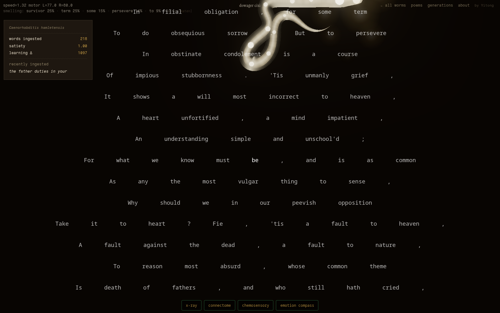

# HamletRNAWorld (jtrotsky's fork)

Simulated *C. elegans* worms crawl over a field of words from *Hamlet* and eat
the words they touch. The words a worm eats, in order, are its poem. A Claude
model scores the poems, and the worms' connectomes evolve towards higher
scores.

**This is a fork.** The project is [Yitong Tseo](https://github.com/YitongTseo)'s,
and the current code lives upstream at
[YitongTseo/HamletRNAWorld](https://github.com/YitongTseo/HamletRNAWorld). The
live site is [wordswordsworms.org](https://wordswordsworms.org). This fork's
`main` is an old snapshot from August 2026. Read and run the upstream repo.

*One worm in the Vivarium viewer, which I built in
[#5](https://github.com/YitongTseo/HamletRNAWorld/pull/5). The panel at top
left counts the words it has eaten. Screenshot from an August 2026 build.*

## What I contributed

**Made the worms more lifelike, and gave them more to read** ([#5](https://github.com/YitongTseo/HamletRNAWorld/pull/5), about 13,500 lines).
Worms gained plasticity, hunger and habituation, so a worm's behaviour changes with what it
has just eaten. Three new texts joined *Hamlet*: the *Tao Te Ching*, *Beowulf* and the
Chinese 道德經, each with its own smell, grammar and judge. I also built the Vivarium viewer
shown above, and a judge backend that runs on any OpenAI-compatible model, local ones
included.

**Found that evolution was not selecting anything** ([#6](https://github.com/YitongTseo/HamletRNAWorld/pull/6)).
Kept genomes did no better than fresh mutants (the result below). The noise between runs was
larger than any difference between genomes. Every worm in a flask now shares one random
seed per generation, and each lineage keeps one judge, so a better genome can show.

**Kept the long runs alive and affordable.** A gene migration would have silently stopped
evolution on three of four processes ([#9](https://github.com/YitongTseo/HamletRNAWorld/pull/9)).
The gardener, not the judge, turned out to be the costly API call, so it now uses prompt
caching and can run every Nth epoch ([#10](https://github.com/YitongTseo/HamletRNAWorld/pull/10)).
Smaller fixes: a probe to find a slow memory leak ([#7](https://github.com/YitongTseo/HamletRNAWorld/pull/7)),
merging two branches that fixed one bug two ways ([#8](https://github.com/YitongTseo/HamletRNAWorld/pull/8)),
and docs that had drifted from the code ([#1](https://github.com/YitongTseo/HamletRNAWorld/pull/1)).

## Has it learned anything?

Not yet, as far as anyone has shown. On 1 September 2026 a test compared
genomes kept from the previous generation against fresh mutants, over 153
generations of one lineage. The kept genomes should have won. They did not:
Cohen's d = −0.009, 95% CI [−0.080, +0.061]. Selection could not tell two
genomes apart. Shared seeds and one judge per lineage followed (#6). Whether
the worms now learn is untested. The upstream `CLAUDE.md` keeps the record.

## Credits

HamletRNAWorld is Yitong Tseo's work, from the simulation and viewer to the
judge and evolution. It builds on the *C. elegans* connectome port in
[heyseth/worm-sim](https://github.com/heyseth/worm-sim), texts from
[Project Gutenberg](https://www.gutenberg.org), and
[nomic-embed-text-v1.5](https://huggingface.co/nomic-ai/nomic-embed-text-v1.5)
with NLTK for the smell and grammar channels.
